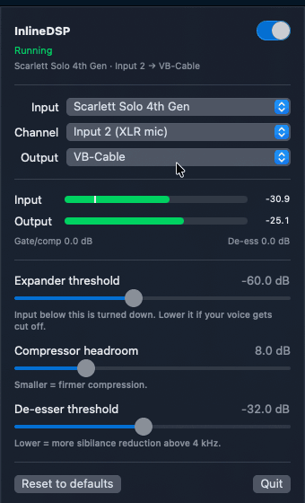

# InlineDSP

**A broadcast vocal chain for your Mac's menu bar.** InlineDSP takes the mic channel from your
audio interface, runs it through a broadcast-style processing chain, and outputs a clean stereo
signal to a virtual audio cable. Any call or streaming app can then use that cable as its
microphone.

<p align="center">
  
</p>

```
mic ─► mono → stereo ─► high-pass 80 Hz ─► gate / compressor ─► tone EQ ─► de-esser ─► limiter (−1.5 dBFS) ─► virtual cable L/R
```

## Features

- **Live tuning from the menu bar:** expander (gate) threshold, compressor headroom and
  de-esser threshold, with input/output meters and gain-reduction readouts. The input meter
  marks the gate threshold, so you can see whether your voice clears it.
- **Pick the input device, mic channel and output device.** Known interfaces select their XLR
  input automatically (for example *Input 2* on a Scarlett Solo 4th Gen).
- **True stereo output:** the mono mic is copied to both channels, bit-identical, at 48 kHz /
  32-bit float. Apps that reject mono virtual mics accept it.
- **Built for real calls:** the engine survives other apps reconfiguring audio devices
  mid-call (it rebuilds in about 0.3 s, with no device-list churn), recovers when a device is
  unplugged and plugged back in, and corrects clock drift between the interface and the cable.
- **Low overhead:** about 0% CPU while idle in the menu bar, about 13 ms of processing
  latency, and nothing beyond Apple's own audio units.
- **Headless mode** for the terminal or launchd, plus an offline `--self-test` that checks the
  DSP chain without any hardware.

## Requirements

- macOS 14 Sonoma or later, on Apple silicon or Intel
- An audio interface or microphone
- A virtual audio cable, such as [VB-Cable](https://vb-audio.com/Cable/) (the default output)
  or [BlackHole](https://github.com/ExistentialAudio/BlackHole)

## Install

### Homebrew

```sh
brew install --cask aleco3lho/tap/inline-dsp
brew install --cask vb-cable          # if you don't have a virtual cable yet (or: blackhole-2ch)
```

Upgrades come through `brew upgrade --cask inline-dsp`.

### Manual

1. Download `InlineDSP-<version>-macos.zip` from [Releases](../../releases). Optionally,
   verify it against the `.sha256` file published with it:
   `shasum -a 256 -c InlineDSP-<version>-macos.zip.sha256`
2. Unzip it and move **InlineDSP.app** to `/Applications`.

### First launch

The app is open source and ad-hoc signed, but not notarized by Apple, so on first launch macOS
will say it can't verify it. Open **System Settings › Privacy & Security**, scroll down and
click **Open Anyway**. Alternatively, run
`xattr -dr com.apple.quarantine /Applications/InlineDSP.app`, or
[build it yourself](#build-from-source). Then allow microphone access when prompted.

## Use

1. Click the waveform icon in the menu bar. Choose your **Input** device and **Channel**, and
   the **Output** cable. The engine starts automatically, and the switch turns it on and off.
2. In Discord, Google Meet, Zoom, OBS or a similar app, choose the cable (e.g. *VB-Cable*) as
   the **microphone**.
3. Speak and watch the meters. If quiet passages get cut, drag **Expander threshold** to the
   left of where your voice peaks on the input meter. **Reset to defaults** restores the tuned
   values.

Your choices persist across launches.

### Apps that use Apple voice processing

Some apps capture through Apple's built-in echo cancellation (voice processing).
**WhatsApp** is one. In our testing, voice processing delivered silence from virtual cables
(both BlackHole and VB-Cable), and it rejects aggregate devices as input, so these apps cannot
receive InlineDSP's output. For them:

- select your **interface** as the microphone instead (you get the raw mic plus the app's own
  processing), and
- make sure your mic is on the interface's **first channel**, because voice processing only
  reads that one. On a Scarlett Solo 4th Gen the XLR input is *Input 2*; merging Inputs 1 and 2
  in Focusrite Control 2 fixes this.

Discord and Google Meet use their own processing and work with the cable.

## Command line

The app binary also runs without UI:

```sh
InlineDSP.app/Contents/MacOS/inline-dsp --headless                        # run in the terminal
InlineDSP.app/Contents/MacOS/inline-dsp --list-devices                    # devices and input channels
InlineDSP.app/Contents/MacOS/inline-dsp --self-test                       # verify the DSP chain offline
InlineDSP.app/Contents/MacOS/inline-dsp --headless --input "MacBook Pro Microphone" --output BlackHole
```

| Option | Meaning |
|---|---|
| `--headless` | Run without the menu bar UI; stop with Ctrl-C or SIGTERM |
| `--input NAME\|UID` | Input device (default: the macOS default input) |
| `--output NAME\|UID` | Output device (default `VB-Cable`) |
| `--input-channel-name NAME` / `--input-channel N` | Capture a specific channel (default: the device's mic input) |
| `--buffer FRAMES` | I/O buffer size (default 128) |
| `--status-interval SEC` | Seconds between status log lines; 0 disables (default 30) |

Device names are matched ignoring case, spaces and punctuation, so `vbcable` finds
`VB-Cable`. Settings chosen in the menu bar also apply to headless runs.

## Build from source

Requires the Xcode Command Line Tools (Swift 6).

```sh
git clone https://github.com/AleCo3lho/inline-dsp.git && cd inline-dsp
swift build -c release && .build/release/inline-dsp --self-test   # quick check
scripts/build-app.sh                                              # universal dist/InlineDSP.app + zip
```

## How it works

**Routing.** On macOS, AVAudioEngine's input and output nodes share one I/O unit and cannot be
bound to two different devices. InlineDSP therefore joins your interface and the cable in a
**private aggregate device**. It exists only inside the app and is removed when the app quits.
The interface is the clock source and the cable is drift-compensated by Core Audio. Channel
maps pick the mic channel on the way in and send L/R only to the cable on the way out, so
nothing plays through your speakers or headphones.

**Processing** uses Apple's audio units, with these measured behaviours:

| Stage | Unit | Notes |
|---|---|---|
| High-pass | `AVAudioUnitEQ` | 80 Hz, 12 dB/oct (−3 dB at 80 Hz, −17 dB at 30 Hz) |
| Gate / compressor | AUDynamicsProcessor | No ratio parameter: output approaches *threshold + headroom*, so headroom acts as the ratio control |
| Tone EQ | `AVAudioUnitEQ` | −3 dB wide cut at 350 Hz, +3 dB shelf at 5 kHz |
| De-esser | AUMultibandCompressor | Only the top band (≥ 4 kHz) compresses. The unit's crossovers don't sum flat (stock layout notches about 6 dB near 1 kHz), so the lower crossovers are parked below 22 Hz, measured flat within 0.25 dB below 4 kHz |
| Limiter | AUPeakLimiter | Fixed 0 dBFS ceiling; +1.5 dB pre-gain and −1.5 dB trim give a true −1.5 dBFS ceiling |

**Device changes.** When a call starts, the calling app may reconfigure audio devices, and
AVAudioEngine stops itself in response. InlineDSP waits for the change to settle, then builds a
fresh engine on the same aggregate. Measured, that's about 1.6 s of silence once, with no
device-list churn. A watchdog rebuilds the engine if the input ever delivers exact digital
silence (a live mic always shows some noise), and unplugged devices are retried with backoff.

## Privacy & security

- **Audio stays on your Mac.** InlineDSP contains no networking code, collects no analytics,
  and records nothing to disk.
- **What it changes on your system:**
  - It sets the selected input and output devices to **48 kHz** when you start the engine.
  - It applies a 48 kHz / 32-bit float stereo stream format to the output cable.
  - It creates a **private** aggregate device (invisible to other apps) and removes it when it
    stops.
  - It stores your choices in the app's preferences (`defaults read io.github.aleco3lho.inline-dsp`).
- **Permissions:** the microphone only.
- **Builds:** release builds are ad-hoc signed but not notarized. The source is all here, and
  `scripts/build-app.sh` reproduces the release artifact.

## License

[MIT](LICENSE)
